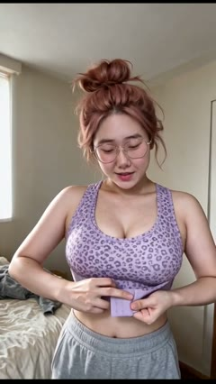
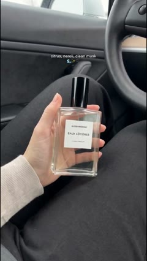

# Awesome Ads Clone

Rebuild a reference ad for your own product with **one media MCP**. Connect EvoLink MCP to a shell-capable agent, give it a reference video and your product and creator assets, and follow the seven-step method from shot breakdown to final export.

## 📊 Overview

| Evidence | Count |
| --- | ---: |
| Documented finished rebuilds | 4 |
| Documented drafts | 2 |
| Tests with rebuild videos | 6 |

The collection draws on 12 rebuilds from the AI Ad Clone Pack. Start with the [front-clasp try-on](#case-2) to see how correcting a single input fixed the shot, or the [perfume demo](#case-5) for a smaller, hands-only exercise. Historical costs describe individual runs. The source pack provides no campaign performance data.

## ⚡ Quick Start

1. Connect [EvoLink MCP](docs/mcp-setup.md) in a shell-capable agent such as Codex or Claude Code. Have FFmpeg and FFprobe available for extraction and editing.
2. Give your agent a reference video, product photo and description, and creator photo or casting brief. Paste the [ready-to-copy agent brief](docs/agent-brief.md).
3. Review the shot plan, first frames, and price estimates. The agent uses EvoLink MCP for image and clip generation, then assembles the accepted clips locally.

[Read the seven-step methodology](docs/methodology.md) · [Optional Gemini video and audio read](docs/gemini-video-reader.md)

## 📑 Menu

| Case | What it shows | Evidence |
| --- | --- | --- |
| [Evopaste toothpaste tabs](#case-1) | Visual hook, action, and pack reveal | Finished |
| [E-bra front-clasp try-on](#case-2) | Correct garment layers by simplifying the inputs | Finished |
| [Taqueritos chips](#case-4) | Conflicting start and end frames produced a dissolve | Draft |
| [Gloss Moderne perfume](#case-5) | Plan a four-shot, hands-only product demo | Draft |
| [Gym Day vlog](#case-6) | Resume from the last usable frame | Finished |
| [Romper talking head](#case-7) | Trim around wardrobe drift and inspect the dialogue | Finished |
| [Six more rebuilds](cases/output-only.md) | Charger, balm, shake, serum, sneakers, and fragrance | Outputs |

## Documented cases

### Case 1: [Evopaste toothpaste tabs](cases/c1-evopaste-toothpaste-tabs/README.md)

**Separate the hook, demo, and product reveal.** Three clips retained the teeth hook and product close-up. The demo still missed the spit-into-cup action. Video generation cost $2.52 in this run.

Type: Finished rebuild · Date: 2026-11-05

### Case 2: [E-bra front-clasp try-on](cases/c2-front-clasp-sports-bra/README.md)

**If the product belongs under a tee, show that in the start frame.** Removing the separate bra photo prevented the model from putting the bra on top of the shirt in the final gesture shot.

Type: Finished rebuild · Date: 2026-11-10

### Case 4: [Taqueritos chips skit](cases/c4-taqueritos-chips/README.md)

**Verify the start and end frames can be joined by one camera move.** Bags and legs shifted between inputs, and the model inserted a dissolve in the middle of the planned continuous shot.

Type: Draft rebuild · Date: 2026-11-10

### Case 5: [Gloss Moderne perfume demo](cases/c5-gloss-moderne-perfume/README.md)

**Give the spray, capped bottle, open box, and pack close-up distinct starting states.** The delivered draft preserved the sprays and cuts. Small label type remained soft.

Type: Draft rebuild · Date: 2026-11-10

### Case 6: [Gym Day vlog](cases/c6-gym-day-vlog/README.md)

**Use the last usable frame to continue a long action.** The creator sat up halfway through a hip-thrust take. The second generation began from the earlier low pose, which let the edit complete the exercise beat.

Type: Finished rebuild · Date: 2026-11-12

### Case 7: [Romper talking head](cases/c7-romper-talking-head/README.md)

**Check the wardrobe from every angle the script calls for.** Cutting a turn at a speech pause hid an unexpected low-back opening, with a shorter line and an earlier cut as the tradeoff.

Type: Finished rebuild · Date: 2026-11-12

## Acknowledgements

The [case inventory](data/cases.json) records the local source pack, media provenance, and evidence status. Original ads and comparison clips that contain third-party footage remain in the source pack. If you spot an attribution or rights issue, please flag it with the case ID. See [how to document a case](docs/maintenance.md) for contributions.
