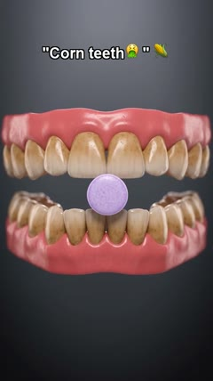

# Evopaste toothpaste tabs

[Watch or download the rebuild](rebuild.mp4?raw=true) · 21.18 s · Finished · 2026-11-05

**Use a visual hook to introduce the problem, then give the demonstration and the pack its own shot.**

## What was rebuilt

The reference opens with an exaggerated yellow-teeth visual, then cuts to use and a close product reveal. The rebuild kept those three beats and replaced the creator and pack with Evopaste chewable toothpaste tabs.

## The production decision

Three clips separated the hook, foaming demo, and pack shot. The labels were tied to the pack image. The closing selfie needed a local horizontal flip to correct mirrored text.

## Result and limits

The run delivered a 21.18-second export. The demo omitted the planned spit-into-cup beat and left purple foam on the lips in the closing smile. Historical video spend was $2.52 across the three clips.

Source: `04-Clone-Cases/c1-Evopaste-toothpaste-tabs/rebuild-plan.md` in the AI Ad Clone Pack. See the [asset inventory](../../data/cases.json) for the original file mapping.
