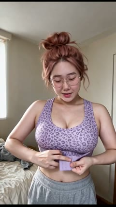

# E-bra front-clasp try-on

[Watch or download the rebuild](rebuild.mp4) · 17.50 s · Finished · 2026-11-10

**When the product must be hidden, let the start frame establish the garment layer and drop the conflicting packshot.**

## What was rebuilt

The rebuild retained a front-clasp demonstration, a try-on, and hand-gesture shots. The replacement pack showed a lavender patterned bra with an E mark.

## The production decision

The front-clasp shot needed a motion reference after earlier takes missed the sequence of hands and clasp. For the final gesture, a separate product image made the bra appear outside the tee. The accepted shot used first-frame image-to-video with a start frame that already showed the tee and text for the gesture.

## Result and limits

The 17.50-second final retained the front clasp, back mark, and patterned strap. The recorded final cut points were within two frames of the reference. Room tone got quieter from shot to shot. Historical project spend was about $7.50, including retries.

Source: `04-Clone-Cases/c2-E-bra-try-on/rebuild-plan.md` in the AI Ad Clone Pack. See the [asset inventory](../../data/cases.json) for the original file mapping.
