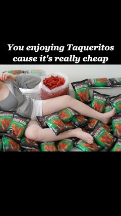

# Taqueritos chips skit

[Watch or download the rebuild](rebuild.mp4) · 8.20 s · Draft · 2026-11-10

**Check whether the start and end frames can be joined by the camera move before submitting.**

## What was rebuilt

The skit used a feet-to-face camera move over a sofa covered in chip bags, then cut to a reaction and pack reveal. The run swapped the performer and target snack packaging.

## The production decision

The first and last frames of the sofa move put the legs and clear bags in different places. The model bridged the disagreement with a dissolve. The proposed repair was to derive both endpoints from one wider image with only a change in framing.

This is the historical first-clip prompt for the failed take described above. [Clip prompt](clip-prompt.txt).

## Result and limits

The 8.20-second export is a draft. The first shot still dissolves at roughly 2.15–2.60 seconds. The repair appears in the plan as a proposal. The recorded spend through the draft was about $1.90.

Source: `04-Clone-Cases/c4-Taqueritos-chips-DRAFT/rebuild-plan.md` in the AI Ad Clone Pack. See the [asset inventory](../../data/cases.json) for the original file mapping.
