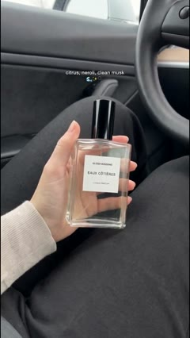

# Gloss Moderne perfume demo

[Watch or download the rebuild](rebuild.mp4) · 7.17 s · Draft · 2026-11-10

**Prepare a start frame for each physical state of the product and describe the action in observable beats.**

## What was rebuilt

The hands-only parked-car demo follows four product beats: spray, capped bottle, open box, and package close-up. The rebuild used the replacement perfume pack and separate input frames for the states.

## The production decision

The spray clip required two small bursts with a clear pause and nozzle reset. In the bottle clip, frame review found visible rotation that the video reader had missed, while the planned translation was absent.

This is the historical spray-clip prompt. [Clip prompt](clip-prompt.txt).

## Result and limits

The 7.17-second delivered draft kept the cut timings and both spray beats. The mist faded quickly and some small type softened at the delivered quality. Historical spend including the reader was about $2.43.

Source: `04-Clone-Cases/c5-Gloss-Moderne-perfume/rebuild-plan.md` in the AI Ad Clone Pack. See the [asset inventory](../../data/cases.json) for the original file mapping.
