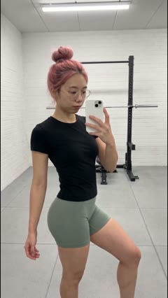

# Gym Day vlog

[Watch or download the rebuild](rebuild.mp4) · 20.08 s · Finished · 2026-11-12

**Continue a demanding physical action from the last usable frame when the long take drifts.**

## What was rebuilt

The creator-only swap preserved the vlog sequence of mirror selfie, kitchen, door, and exercise. The kitchen containers remained generic props.

## The production decision

The original hip-thrust generation performed one rep and then drifted into the creator sitting up. The team used the frame at 3.0 seconds as the continuation input, generated the next beat, and joined it during the low hold.

This is the historical hip-thrust continuation prompt. [Clip prompt](clip-prompt.txt).

## Result and limits

The final ran 20.08 seconds versus 20.03 seconds for the reference. The recorded cut timings were within 0.2 seconds. The rebuild kept normalized room tone. Historical spend including the continuation and reader was about $5.16.

Source: `04-Clone-Cases/c6-Gym-day-vlog/rebuild-plan.md` in the AI Ad Clone Pack. See the [asset inventory](../../data/cases.json) for the original file mapping.
