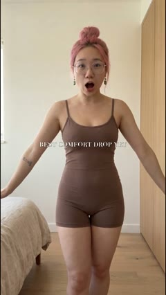

# Romper talking head

[Watch or download the rebuild](rebuild.mp4?raw=true) · 16.62 s · Finished · 2026-11-12

**Lock garment views before generation and check dialogue before choosing a trim to hide drift.**

## What was rebuilt

The reference combined a side-profile fit hook, a talking head, garment gestures, and a turn. The replacement used the supplied creator and a plain mocha romper built from the target description.

## The production decision

The second generation produced a lower back cut than the wardrobe target and added a small tattoo. The chosen edit ended the turn at a dialogue pause before the back appeared, then resumed on the first usable front-facing frame.

This is the historical side-profile opening prompt. [Clip prompt](clip-prompt.txt).

## Result and limits

The 16.62-second v2 still contains the accepted tattoo. The edit removed part of a spoken line and moved the third cut about 1.42 seconds earlier than the reference. Recorded production spend was about $3.02. The final edit used existing footage.

Source: `04-Clone-Cases/c7-Romper-talking-head/rebuild-plan.md` in the AI Ad Clone Pack. See the [asset inventory](../../data/cases.json) for the original file mapping.
