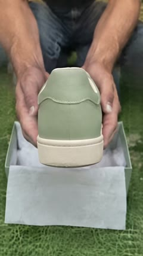

# Output-only tests

These six rebuild files came with the second batch in the AI Ad Clone Pack. The pack supplied the exports and comparisons. Production settings, exact prompts, costs, and run dates were unrecorded in this batch. Durations below come from the delivered files.

## Foldable solar charger

[Watch or download the rebuild](n1-solar-charger/rebuild.mp4) · 10.08 s

## Red balm tin

[Watch or download the rebuild](n2-balm-tin/rebuild.mp4) · 15.07 s

## DAILYFORM shake

[Watch or download the rebuild](n3-dailyform-shake/rebuild.mp4) · 17.06 s

## VELORA serum

[Watch or download the rebuild](n4-velora-serum/rebuild.mp4) · 14.05 s

## PACELO sneaker unboxing

[Watch or download the rebuild](n5-pacelo-sneakers/rebuild.mp4) · 18.08 s

## VELORA Rose 01

[Watch or download the rebuild](n6-velora-rose/rebuild.mp4) · 15.07 s
